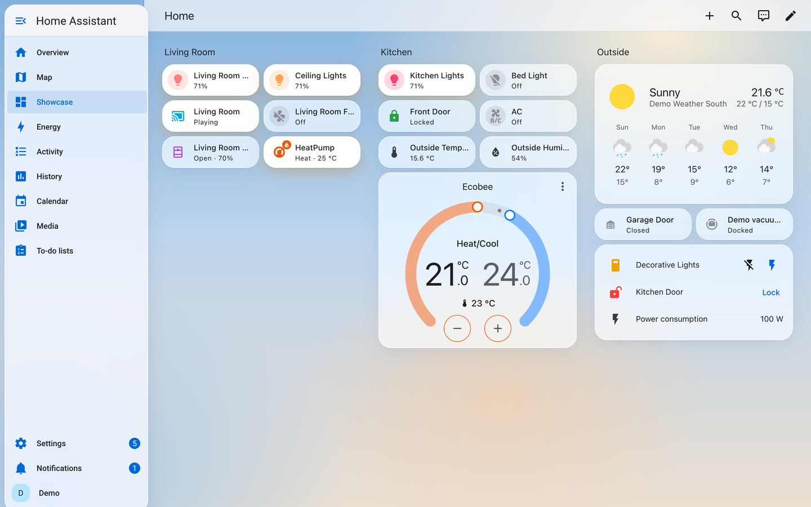
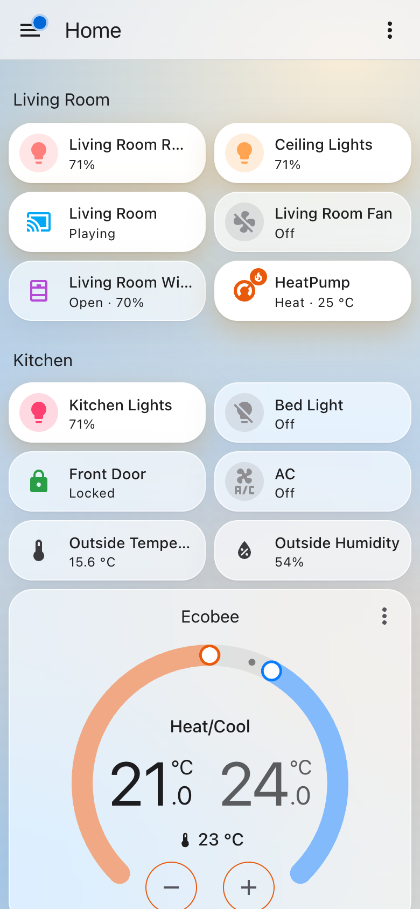
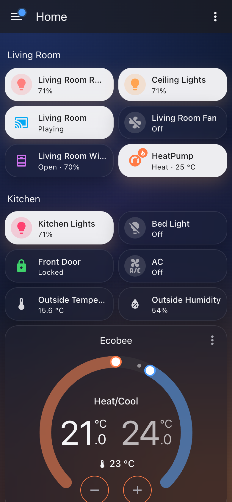
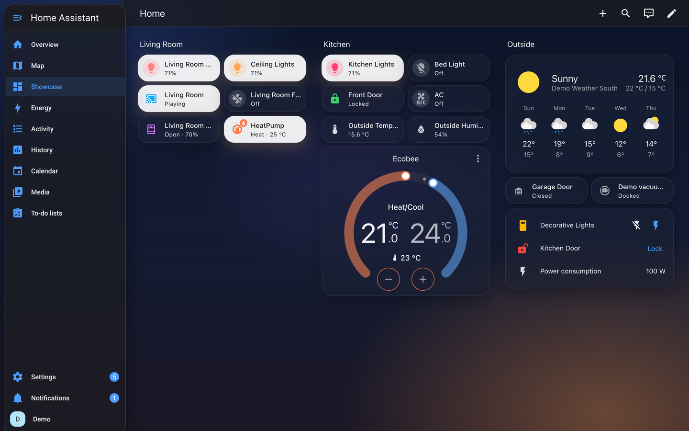
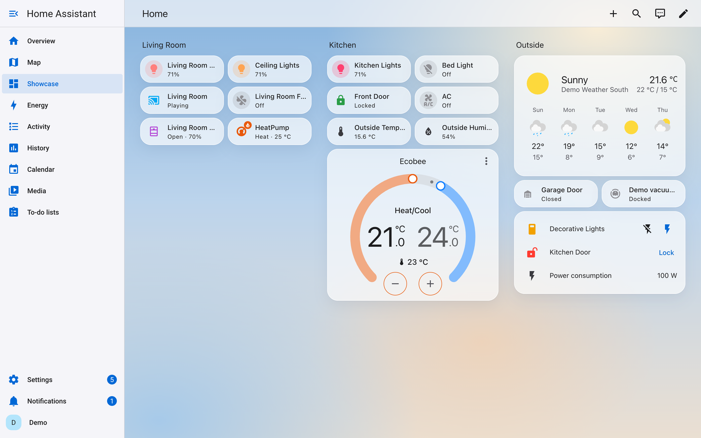

# Clear Sky

A translucent theme for Home Assistant: frosted cards on a sky gradient, light and dark mode in one theme.



| Light | Dark |
|---|---|
|  |  |



## What you get

- **One theme, two modes.** It follows the light or dark setting of your profile or device.
- **Three layers.** A sky gradient behind dashboards, cards as frosted panes, a calm solid background for settings and editors.
- **System fonts only.** SF Pro on Apple devices, the platform font elsewhere. Nothing is downloaded.
- **Optional extras with card-mod:** blur behind cards, a floating sidebar, rounded-square icons in settings, and tiles of switched-on lights, media players, climate and similar entities turn into a bright, opaque plate.

Without card-mod the theme still works: colours, radii and translucent cards come from plain theme variables, the cards stay matte.



## Requirements

- Home Assistant with themes enabled. Tested with Home Assistant 2026.11.2 (November 2026).
- Optional: [card-mod](https://github.com/thomasloven/lovelace-card-mod) 4.x for the blur and the extras. Tested with card-mod 4.2.1.

## Installation

### Marketplace (HACS)

1. Open **Settings → Marketplace** (or HACS on older versions).
2. Search for **Clear Sky** and download it.
   Until the theme is listed in the default catalog, add this repository as a custom repository of type **Theme** first.
3. Reload themes: **Developer tools → Actions → `frontend.reload_themes`**.

### Manual

1. Copy `themes/clear_sky.yaml` into the `themes` folder of your configuration.
2. Make sure your `configuration.yaml` loads that folder:

   ```yaml
   frontend:
     themes: !include_dir_merge_named themes
   ```

3. Restart Home Assistant or run `frontend.reload_themes`.

## Use the theme

Open your **profile**, choose **Clear Sky** under *Theme*, and pick *Auto*, *Light* or *Dark*.

## Optional: card-mod

The theme contains `card-mod-card`, `card-mod-sidebar`, `card-mod-root` and `card-mod-config` rules. They only apply when card-mod is installed. For theme rules, card-mod recommends loading it as a frontend module instead of a dashboard resource:

```yaml
frontend:
  themes: !include_dir_merge_named themes
  extra_module_url:
    - /local/community/lovelace-card-mod/card-mod.js
```

Adjust the path to where card-mod is installed on your system.

The "bright plate" applies to tile cards of these domains when they are on: `light`, `switch`, `fan`, `media_player`, `climate`, `input_boolean`, `humidifier`, `water_heater`, `vacuum`, `remote`, `siren`, `automation`, `script`. Sensors are left out on purpose: the tile card marks every entity with a value as active.

## Optional: Bubble Card and navbar-card

If you use [Bubble Card](https://github.com/Clooos/Bubble-Card) or [navbar-card](https://github.com/joseluis9595/lovelace-navbar-card), the theme styles their pop-ups and the bottom bar as glass. Without these cards the variables do nothing.

## Customise

Change the variables below in a copy of the theme, or override them with card-mod.

| Variable | Used for |
|---|---|
| `lovelace-background` | Sky gradient behind dashboards (separate values for light and dark) |
| `ha-card-background` | Card fill, a translucent white or dark |
| `glass-filter` | Blur and saturation behind cards and the sidebar (card-mod) |
| `glass-on-plate`, `glass-on-plate-text` | Plate colour and text colour of active tiles (card-mod) |
| `glass-on-glow` | Warm glow under active tiles (card-mod) |
| `primary-color`, `ha-color-primary-*` | Accent colour and the blue scale the frontend uses for buttons and switches |

## Known limits

- Home Assistant does not guarantee theme variables between releases. If something looks off after an update, please open an issue with your version.
- The blur needs a browser with `backdrop-filter` support. Older browsers show the matte cards.
- The card-mod rules target internal elements of the frontend. A frontend update can break them; the theme itself keeps working.

## Contributing

Issues and pull requests are welcome. Please include your Home Assistant version, card-mod version (if used), browser and a screenshot.

## License

[MIT](LICENSE)

This is a community project. It is not affiliated with or endorsed by Home Assistant or the Open Home Foundation.
